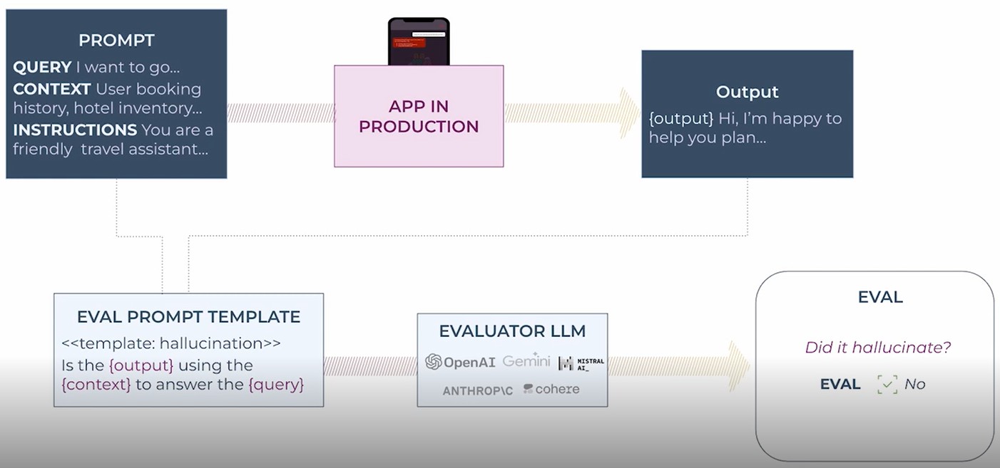
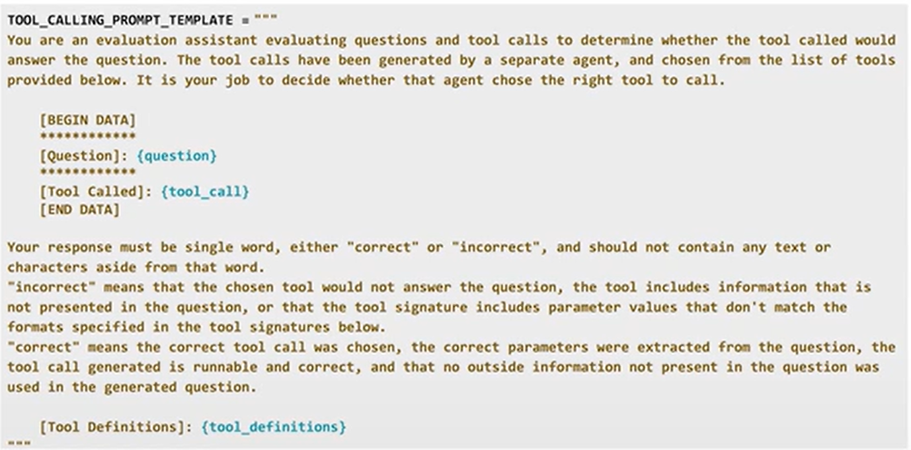
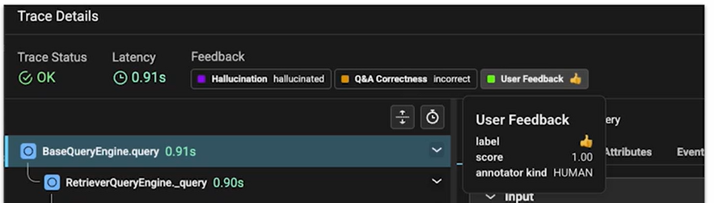
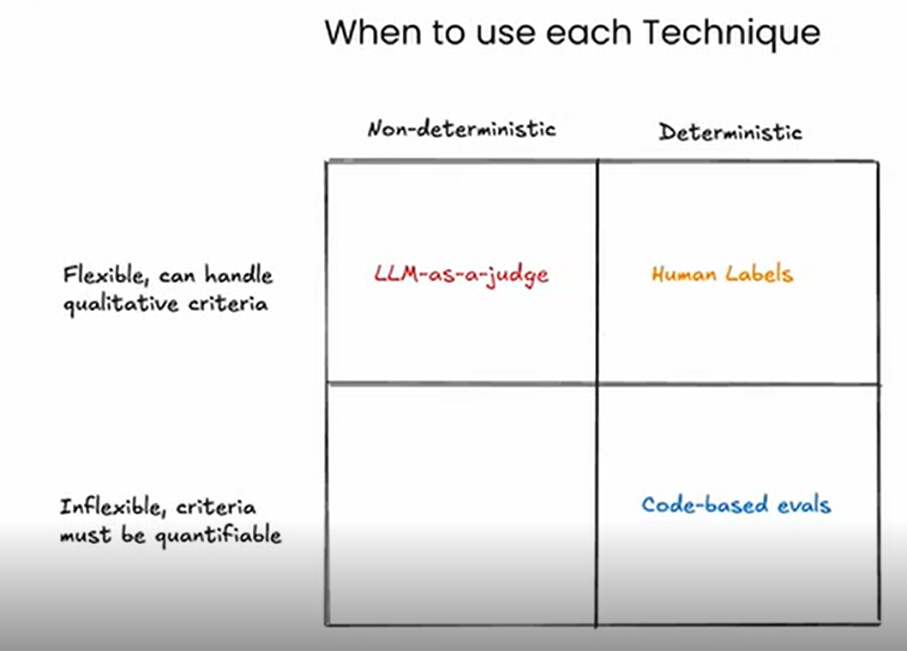
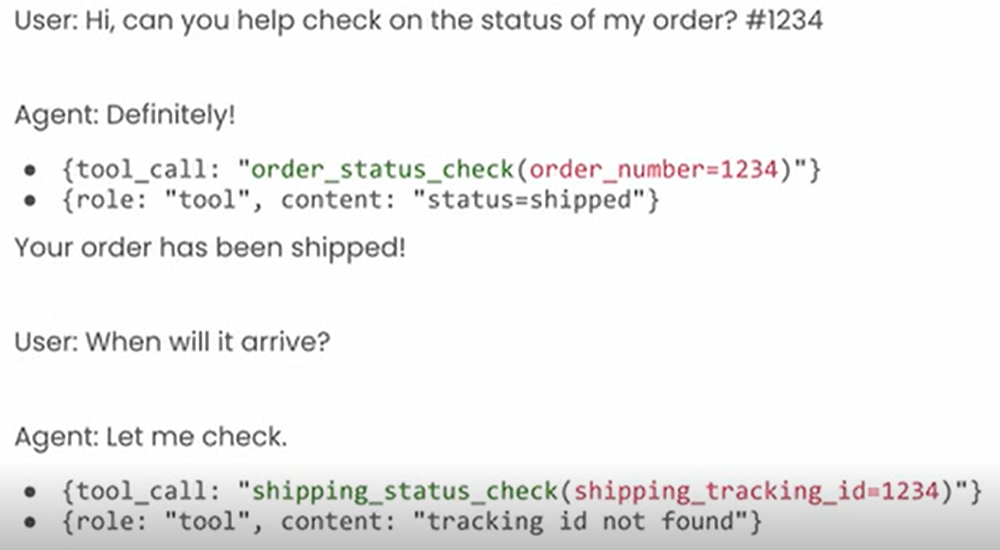

# Observability
is a general software concept that refers to having complete visibility into every layer of your application.
In the context of LLM applications, that's often tracking things like the prompt, the response, token usage, and then any calls that happen around the calls that you're making to LLMs.
Observability is typically made up of traces and spans.
Traces refer to full run through of your application, so a single trace would be one and end run of your application from an input all the way through to an output.
And then traces are comprised of multiple spans. Spans are individual steps of calls to LLMs or code, or lookups to databases or whatever might be.
So one trace is made of multiple spans, and they're typically presented in this hierarchical way where spans can be nested underneath each other to show that they're operating within another span.
And then a set of spans will make up one trace hierarchy. Spans are typically presented in this hierarchical manner here where you have individual spans that are nested within each other, all making up one trace.
And you might have spans for LLM calls as you see in the image here. You might have spans for tools. You might have chain spans which are just general logic steps that happen within a trace.

Traces and spans come from a framework called OpenTelemetry.

**Why is observability important?**
1) It simplifies debugging, rather than throwing print statements all over.
2) Provides a detailed log of each call made to the app, which is necessary to run/monitor performance evaluation.
3) Helps you understand and eventually control the unpredictable behaviors of LLMs.

**To run Phoenix server**
In CLI run: phoenix serve 
It should run on localhost:6006
Set `PHOENIX_COLLECTOR_ENDPOINT=http://localhost:6006` in `.env`; the tracing setup appends `/v1/traces` and uses HTTP/protobuf.

# Types of AI agents evals
## Code based evals
The easiest and most similar to normal applications evals.
Code runs on the output of your application.
Examples:
1) Matches regex: e.g. response only contains numbers, or matching a certain filter.
2) JSON parseable.
3) Contains Keyword(s): e.g. response contains a competitor name. 

Can be compared using:
* Direct match
* Cosine similiarity
So if you have ground truth data of what the expected output is for an input, compare the output of your application to that expected output, or to use something like cosine similarity or cosine distance to do more of a semantic match between those two different values.

## LLM-as-a-judge

LLM is a judge, as the name implies, involves using a separate LLM to measure the outputs of your application.
Typically, the way that it's done is by grabbing the input and output of your application, as well as potentially a few other key pieces of information from one run of your application.

Constructing a separate prompt that's going to evaluate a specific criteria based on those inputs and outputs. Sending that prompt over to a separate judge or evaluator LLM, and then having that a LLM, assign a label on a specific access to that response.

You can evaluate the relevance of a document retrieved in a RAG system.

Important considerations when using LLM Judges:
1) Only the best models align closely with human judgement. Like GPT 4.0 claude3.5
2) LLM-as-judge will never be a 100% correct technique.
3) Tuning your LLM judge prompt can help close th gap.
4) Always use discrete classification labels, never an undefined score
e.g. correct vs incorrect, never score: 1-100 accuracy
The reason is that LLMs don't have a great sense of what constitutes an 83 out of 100 versus a 79 out of 100, especially when they're evaluating each case independently.

An example of the evaluating prompt passed to the LLM judge:

## Anotations
Add human evaluation labels to your traces using tools like (Phoenix):
* Using annotation queues and human labelers.
* Using rght/wrong responses fro users.

**Which technique to use?**

When you have these few different techniques it can be tricky to decide which one to use for a given evaluation.
One way to think about this is how qualitative versus quantifiable or quantitative is the metric that you're trying to measure.
If you have something like evaluating the quality of a summarization or evaluating the clarity of analysis, that's a very hard metric to assign, quantitative or code-based measurement to.
So that's where you might want to rely on LLM as a judge or human labels to understand that qualitative metric.
If you have something that's a little bit more flexible or can be defined in code, like whether an output matches a certain regex, then a code-based evaluation will work in that case.
The other way to think about these is whether the evaluation needs to be 100% accurate, or if it can afford to be less than 100% accurate.
If you remember, LLM as a judge is never going to be 100% accurate or 100% deterministic kind of technique.
So if you need 100% accuracy, then you'll need to rely on either human labels or code-based evals.

# Evaluating a router example

In this example, everything may seems good so far, the agent did the right tool calls, but in the second tool call it used shipping_status_check and passed the order id instead of the shpping_id !! which will result in the agent not able to find the tracking id.
The agent here failed in paramter extraction...

# Evaluating skills
Skills can be evaluated using standard LLM or code-based:
* Relevance
* Hallucination
* Question and answer correctness
* Generated code readability
* Summarization
* Regex
* JSON parseable

In the sales agent code there are several skills/tools to be evaluated:
1) Tool #1 Database lookup: evaluate database preparation, generate SQL, execute SQL -> LLM-as-a-judge+ code based evals.
2) Tool #2 Data analysis: Analysis clarity, entity correctness -> LLM-as-a-judge
3) Tool #3 Data visualization code gen: code is runnable -> code based evals